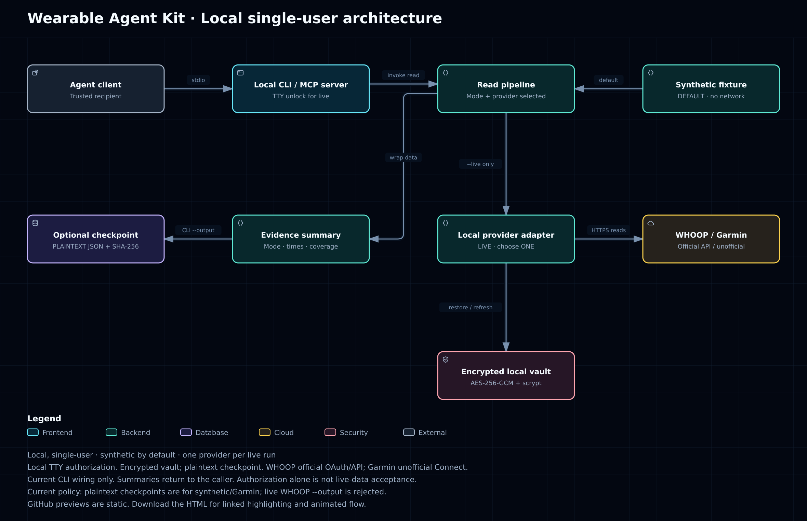

# Wearable Agent Kit

[简体中文](README.zh-CN.md)

**Bring data from your health devices to a personal AI assistant so you can understand changes in sleep, recovery, and training, manage health information, and get evidence-based reports.** This toolkit helps developers build a personal health assistant, currently for one user running locally through a terminal.

The goal is to help an assistant:
- Gather traceable body data, with its source and measurement time
- Explain changes using personal context you provide and available historical trends
- Produce personal health reports with conclusions, evidence, habit suggestions, and missing information

**The toolkit supplies data access and descriptive summaries; the connected agent handles deeper interpretation and habit suggestions.** For example, ask “How did I sleep last night, and has my training changed recently?” The assistant reads the data before answering and explains when the available history is insufficient.

## Start in three steps

Use a trusted Linux/macOS machine with Git and **Node.js 24+**. No third-party runtime dependencies need installing.

**1. Get the project.**

```sh
git clone https://github.com/deanjo/wearable-agent-kit.git
cd wearable-agent-kit
```

**2. Run the offline flow first.** No account or real health data is needed.

```sh
npm run doctor
npm run verify
```

**3. Connect your account and assistant.** Follow the [quickstart](docs/en/quickstart.md) for local authorization, a real read, and MCP configuration (the protocol assistants use to call tools). Enter passwords, passphrases, and tokens only on your machine, never in chat.

## What a report should contain

Ask the assistant to cover four points; see the [analysis guide](docs/en/analysis-guide.md):
- **Conclusion:** observable changes in sleep, recovery, or training
- **Evidence:** sources, measurement dates, and comparable historical records
- **Suggestions:** everyday habits to discuss or try, without diagnosis or treatment
- **Gaps:** missing data and conclusions that cannot yet be drawn

## How data reaches your assistant

Device → vendor platform → this toolkit → agent → personal health report.



“Provider” in the diagram means service integration code. The read-only MCP tool is implemented by this project. Download the HTML from [interactive diagrams and sources](docs/architecture/README.md) to open it locally; GitHub's file view does not run it.

## Current status and limits

The kit provides WHOOP's official API integration, unofficial Garmin Connect access (Garmin international/global accounts only), an encrypted local credential vault, and read-only tools. It does not yet include a long-term health record, automatic multi-device merging, or scheduled report delivery. One-click access from the dot cloud is not supported.

`doctor` checks the environment. `verify` checks files, runs 105 offline tests, and reopens a synthetic summary in a new process. Passing does not prove a live connection: the output includes `liveProviderAcceptance: false`. This release has not completed real-account acceptance; see [validation](docs/validation.md).

A live run selects one provider. Authorization and unlocking require a TTY (an interactive terminal); GUI clients without one cannot unlock live mode. Credentials are encrypted, but exported summaries are plaintext: keep them in a private location outside the repository. Before deployment, review the use restrictions in [WHOOP's API terms](https://developer.whoop.com/api-terms-of-use/) and the [security boundaries](SECURITY.md). A disclaimer does not replace permission.

## Go deeper

[Capabilities](docs/en/capabilities.md) · [Troubleshooting](docs/en/troubleshooting.md) · [Agent instructions](AGENTS.md) · [MIT license](LICENSE) · [Upstream attribution](THIRD_PARTY_NOTICES.md)
