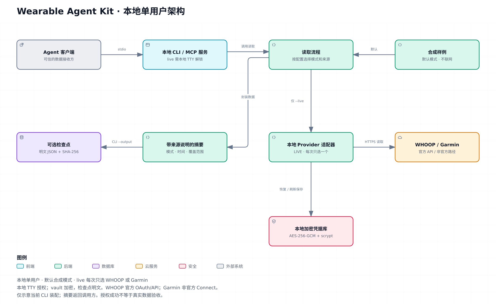

# Wearable Agent Kit

[English](README.md)

**让 Agent 沿着可复现的路径，把可穿戴设备数据整理成有依据的摘要。** 先离线验收，再本地授权，读取 WHOOP 或 Garmin，同时保留日期、新鲜度和缺失记录的边界。

可复用部分包括 Provider 库、本地加密状态、检查点恢复和只读 MCP 接口。教学文档说明常见失败原因，以及在声称“接入成功”前必须取得的证据。

## 适合谁

面向构建**单用户、自托管**接入的开发者和 Agent。WHOOP 使用官方 OAuth/API；Garmin 使用**非官方个人 Connect 路径**，与 Garmin 官方开发者计划分开。本项目 MCP 适配器不由这两家厂商提供或背书。

## 最短路径：无需账号

需要 Node.js **24+**，无需第三方运行时依赖。

```sh
npm run doctor
npm run verify
```

默认是**合成模式**。也可单独生成并读回检查点：

```sh
npm run collect -- --output /tmp/wak-checkpoint.json
npm run read -- --checkpoint /tmp/wak-checkpoint.json
```

本地授权、真实读取和 MCP 配置见[快速开始](docs/zh-CN/quickstart.md)。不要把账号密码或令牌发到 Agent 对话中。

## 怎样才算成功

1. 离线测试通过。
2. 一次合成采集生成检查点。
3. 另一个进程读回该检查点。
4. 真实验收单独记录：用户授权读取、测量时间、覆盖范围、重启恢复和刷新行为。

详见[验收说明](docs/validation.md)。假传输层测试不能验证真实账号或生产服务；调度器与实际送达也需要另行验收。

## 架构与边界



[交互 HTML](docs/architecture/architecture-zh-CN.html) · [SVG](docs/architecture/architecture-zh-CN.svg) · [图源与验收说明](docs/architecture/README.md)。下载 HTML 后用本地浏览器打开；GitHub 文件页面不会执行交互页面。

默认使用合成模式；live 每次只选一个服务商，在本地 TTY 完成授权和解锁。加密凭据库与可选的明文摘要检查点是两种不同存储。

Agent → 本项目 MCP 适配器 → Provider 库 → WHOOP API / Garmin Connect。

MCP 适配器由本项目实现。WHOOP 提供官方 API，不提供这个适配器；Garmin 接入含上游衍生代码，归属见 `THIRD_PARTY_NOTICES.md`，不声称全部原创或属于官方 Garmin MCP。

每位部署者把自己的加密会话状态保存在显式选择的本地目录。保险库口令在本地输入，不与保险库一起保存。解锁后运行进程可以解密；机器或进程被攻破时数据仍可能暴露。本项目不提供统一的凭据托管服务。具体本地输入方式见[快速开始](docs/zh-CN/quickstart.md)。

```text
src/
  providers/        WHOOP 官方 API；Garmin 非官方 Connect
  core/             数据契约、本地授权与状态辅助模块
  analysis/         描述性、有证据边界的摘要
  mcp/              本地只读 stdio 接口
scripts/            环境检查与离线验收
tests/              合成样例与回归测试
deploy/reference/   本地客户端配置
examples/           合成示例
docs/en/            英文快速开始、能力、排障、分析指南
docs/zh-CN/         对应中文指南
```

首版 Agent 传输采用本地 stdio。接入远程 dot 或其他 Agent 平台，还需审查运行时适配及身份边界；这不是现成的多用户托管服务。不承诺原始波形、设备全量同步、诊断建议或定时准点送达。详见[能力说明](docs/zh-CN/capabilities.md)。

## 去哪里找答案

- **Agent 操作约定：** [AGENTS.md](AGENTS.md)
- **登录、回调、刷新、分页或工具缓存：** [排障指南](docs/zh-CN/troubleshooting.md)
- **把记录整理成可靠报告：** [分析指南](docs/zh-CN/analysis-guide.md)
- **秘密管理与发布审查：** [SECURITY.md](SECURITY.md)
- **许可证及上游归属：** [LICENSE](LICENSE)、[THIRD_PARTY_NOTICES.md](THIRD_PARTY_NOTICES.md)

部署或按具体用途分发前，请审查 [WHOOP API 条款](https://developer.whoop.com/api-terms-of-use/)。其 2026-10-06 条款限制专业建议用途，并禁止将开发凭据嵌入开源项目；免责声明不能替代许可。
