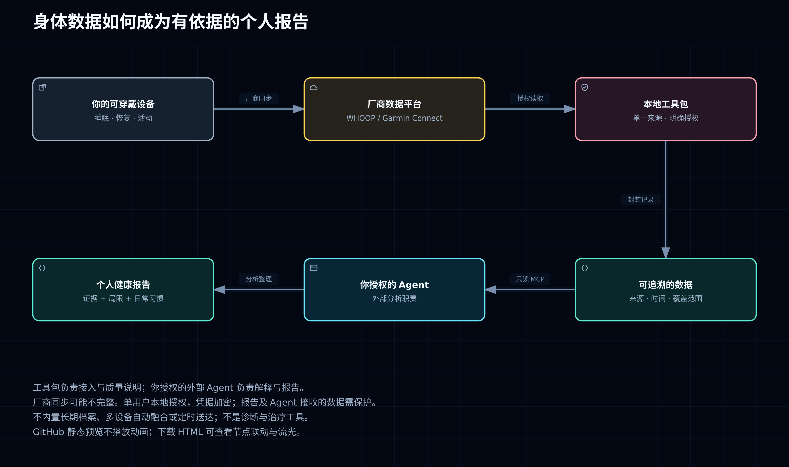

# Wearable Agent Kit

[English](README.md)

**把分散在健康硬件中的身体数据交给个人 AI 助手，帮助你理解睡眠、恢复和训练变化，管理健康信息并获得有依据的报告。** 这是供开发者搭建个人健康助手的工具包，目前面向单用户、本地终端运行。

目标是让助手能：
- 汇集来源可追溯的身体数据，知道数据来自哪里、何时测量
- 结合你提供的个人信息和可用历史趋势，解释变化
- 输出包含结论、依据、习惯建议及缺失信息的个人健康报告

**当前工具包负责取数和描述性摘要，深入解读与习惯建议由接入的 Agent（智能助手）负责。** 例如，你问“昨晚睡得怎样，近期训练有没有变化？”，助手先取数，再根据实际记录回答；缺少历史数据时说明不足。

## 三步开始

需要可信的 Linux/macOS 机器、Git 和 Node.js **24+**，无需安装第三方运行时依赖。

**1. 下载项目。**

```sh
git clone https://github.com/deanjo/wearable-agent-kit.git
cd wearable-agent-kit
```

**2. 先跑通离线流程。** 无需账号，不读取真实健康数据。

```sh
npm run doctor
npm run verify
```

**3. 接入自己的账号和助手。** 按[快速开始](docs/zh-CN/quickstart.md)完成本地授权、真实读取和 MCP（供助手调用工具的协议）配置。通过本地授权流程输入凭据，不要发进聊天；必要认证信息会发送给对应服务商。

## 能得到怎样的报告

建议让助手按四点回答，详见[分析指南](docs/zh-CN/analysis-guide.md)：
- 结论：睡眠、恢复或训练有哪些可观察变化
- 依据：来源、测量日期、可比较的历史记录
- 建议：适合讨论或尝试的日常习惯，不做诊断或治疗
- 缺失：缺哪些数据，哪些判断暂时不能作出

## 数据怎样到达助手

设备 → 厂商平台 → 本项目 → Agent → 个人健康报告。



[打开暗色交互图与技术架构](docs/architecture/README.md)：下载 HTML 后用浏览器打开，可点击节点查看联动，并开关流光动画。GitHub 上方仅显示静态预览。只读 MCP 工具由本项目实现。

## 安全使用

只读工具也会传出健康数据。本地接入不代表助手的模型在本机运行：先确认接收方、保存方式和授权范围，只提供必要数据。凭据库加密，但终端输出、报告和客户端日志可能是明文，须私有保存，勿公开或提交到 Git。详见[安全说明](SECURITY.md)。

## 当前进度与边界

已提供 WHOOP 官方 API（数据接口）、Garmin 非官方 Connect 接入（佳明仅国际区）、本地加密凭据库和只读工具。尚未内置长期健康档案、多设备自动融合或定时发报告系统，也不支持 dot 云端一键连接。

`doctor` 检查环境；`verify` 核对文件、运行离线测试（数量以当次输出为准），并用新进程读回合成摘要。成功不等于真实接入：输出 `liveProviderAcceptance: false`，本版本尚未完成真实账号验收，见[验收说明](docs/validation.md)。

真实模式每次选一家服务商，授权和解锁需要 TTY（交互终端），无终端的图形客户端暂不支持。部署前审查 [WHOOP API 条款](https://developer.whoop.com/api-terms-of-use/)中的用途、加密和保留限制及[安全边界](SECURITY.md)；私有文件权限不等于加密或合规。

## 深入了解

[能力范围](docs/zh-CN/capabilities.md) · [排障](docs/zh-CN/troubleshooting.md) · [Agent 约定](AGENTS.md) · [MIT 许可证](LICENSE) · [上游归属](THIRD_PARTY_NOTICES.md)
